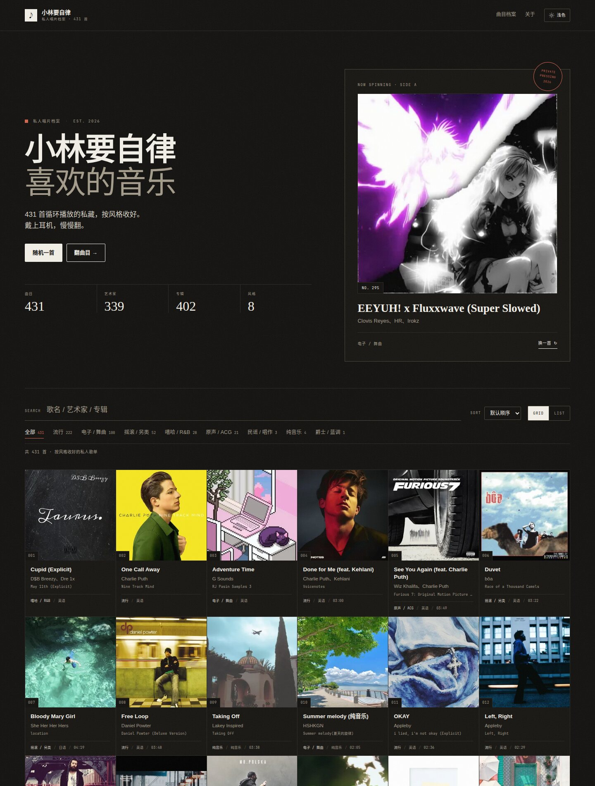
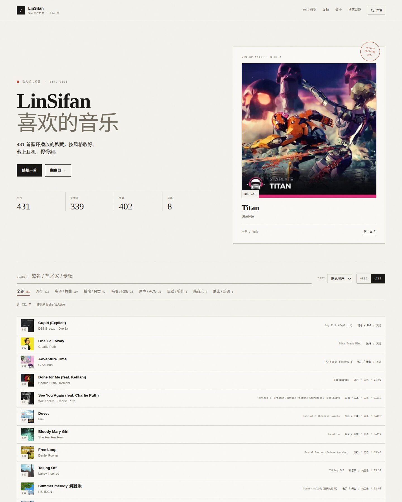
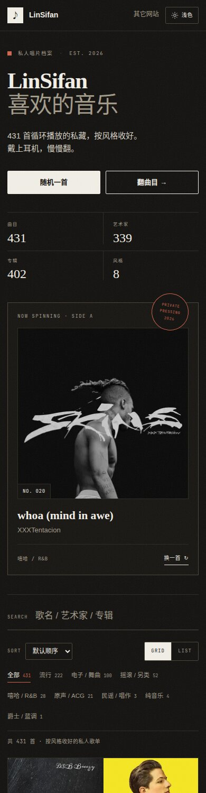
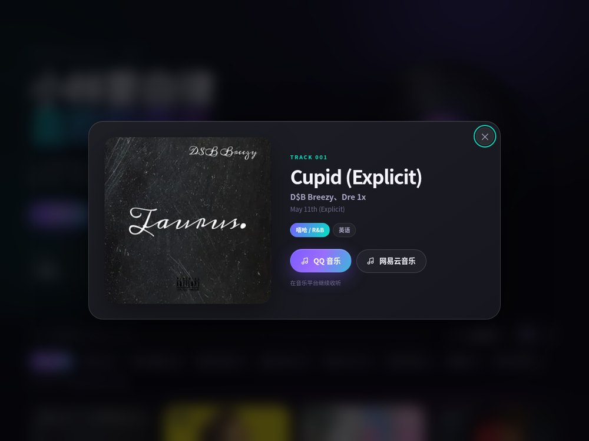
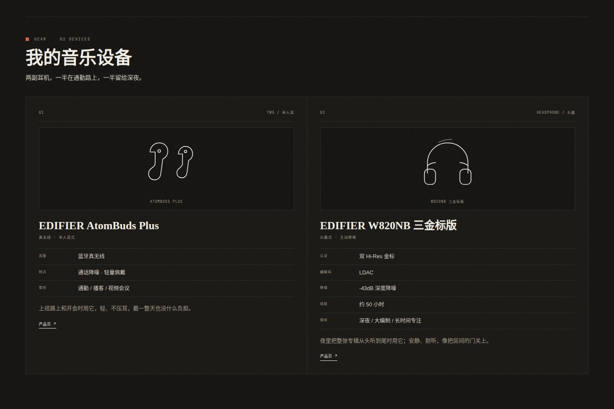

# LinSifan 喜欢的音乐

> 431 首循环播放的私藏，按风格收好。


**在线访问：<https://tuxlin123233.github.io/my-play-list/>**

> 私人唱片档案 · 431 首 · 8 种风格。深色黑胶与浅色纸白两套主题，无渐变。

<p align="center">
  
</p>

## 关于

这是把个人歌单做成的一本静态「私人唱片档案」。原始歌单 437 条收藏，去重后得到 431 首歌；按风格重新分类，并为每首歌准备了专辑封面、时长和音乐平台入口。界面走黑胶杂志 / 私人档案感：暖纸与炭黑两套主题、衬线标题、mono 编号、细线分隔，没有渐变和光晕。

整个网站没有后端，也不依赖前端框架，所有数据在构建时生成，直接部署在 GitHub Pages。

## 功能

- 431 首歌，8 种风格分类
- 搜索歌名、艺术家、专辑
- 按风格筛选，按歌名 / 艺术家 / 专辑 / 时长排序
- 网格 / 列表两种视图
- 随机一首，打开歌曲详情
- 深色黑胶 / 浅色纸白两套主题，自动记住选择
- 无渐变、扁平、杂志感的编辑排版
- 唱片档案动效：入场、滚动淡入、NOW SPINNING 换片、弹窗与 hover，尊重系统减少动态偏好
- 一键跳转 QQ 音乐 / 网易云音乐搜索
- 手机端适配，封面懒加载
- 「其它网站」入口：重力 2048、一事一练、像素小镇、像素画网站与 GitHub
- 「我的音乐设备」：EDIFIER AtomBuds Plus 与 EDIFIER W820NB 三金标版

## 界面预览

<p align="center">
  
  
</p>

<p align="center">
  
</p>

<p align="center">
  
</p>

## 风格分布

| 风格 | 数量 |
| --- | ---: |
| 流行 | 222 |
| 电子 / 舞曲 | 100 |
| 摇滚 / 另类 | 52 |
| 嘻哈 / R&B | 28 |
| 原声 / ACG | 21 |
| 纯音乐 | 4 |
| 民谣 / 唱作 | 3 |
| 爵士 / 蓝调 | 1 |

## 其它网站

- [重力 2048](https://tuxlin123233.github.io/)：一个受重力影响的 2048 小游戏
- [一事一练](https://tuxlin123233.github.io/json-prompt-form/)：AI 长期陪练与存档
- [像素小镇](https://light-field.pages.dev)：云端像素画板：画画、存档、串门，还能投到灯板
- [像素画网站](https://pixel-space-9bn.pages.dev/)：我的像素画作品
- [GitHub](https://github.com/TuxLin123233)：其它开源项目

## 技术栈

- 原生 HTML / CSS / JavaScript，无框架、无构建步骤
- 封面：酷我音乐，下载后统一转为 320×320 WebP
- 风格 / 语言：QQ 音乐
- 部署：GitHub Pages

## 项目结构

```text
.
├── index.html
├── favicon.svg
├── css/
│   └── style.css
├── js/
│   ├── app.js
│   └── data.js
├── covers/                 # 431 张本地封面
├── data/
│   ├── playlist.csv        # 原始歌单
│   ├── songs_raw.json      # QQ 音乐抓取结果
│   ├── kuwo_songs.json     # 酷我封面 / 时长
│   └── songs.json          # 合并后的最终数据
├── docs/                   # README 预览图
└── tools/
    ├── fetch_metadata.py
    └── build_site_data.py
```

## 本地运行

```bash
python3 -m http.server 8000
# 打开 http://localhost:8000/
```

直接双击 `index.html` 也能打开，但建议用本地服务器。

## 更新歌单

1. 把新的歌单导出为 CSV，替换 `data/playlist.csv`。列名需要是：`歌曲名,艺术家,专辑名`。
2. 抓取风格与平台信息：

   ```bash
   python3 tools/fetch_metadata.py
   ```

3. 合并数据并下载封面：

   ```bash
   python3 tools/build_site_data.py --download-covers
   ```

4. 提交并推送：

   ```bash
   git add .
   git commit -m "更新歌单"
   git push
   ```

## 说明

- 歌单、封面和音乐元数据版权归原作者及平台所有，本项目仅作个人展示。
- 代码以 MIT License 开源。

---

Made by [TuxLin123233](https://github.com/TuxLin123233)
